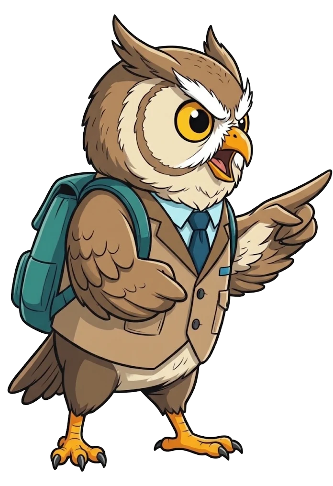
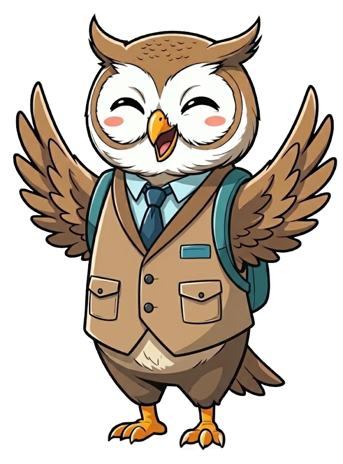
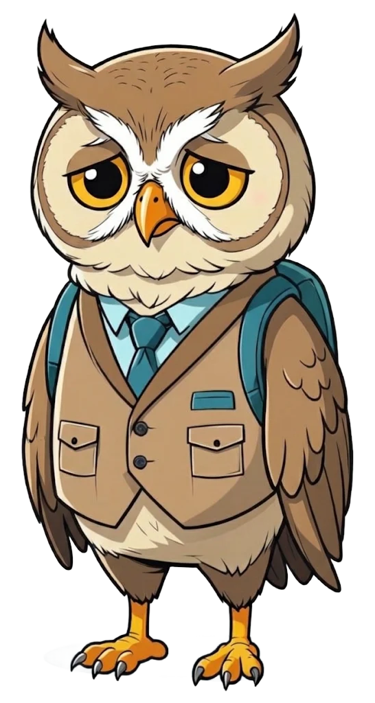
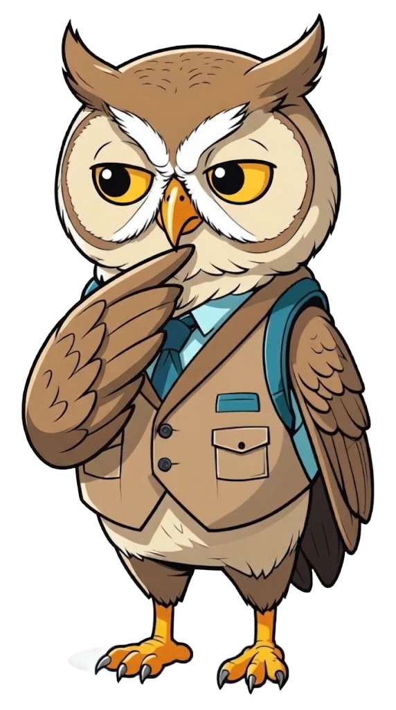

# Claude のポーズの絵の記録

正面以外のポーズの絵を、どう作ったかの記録(手で書く。仕様: `docs/05-persona-illustration/README.md`「ポーズ」「記録」)。正面の立ち姿の記録は [claude.record.md](claude.record.md)。

## 共通

| 項目 | 内容 |
|---|---|
| 作った日 | 2026-11-13 |
| 使ったサービス | Google の Gemini(アプリ)。モデルの表示は「hydrogen」 |
| 添付した画像 | 正面の立ち姿(候補7。[claude-front.png](../../../app/web/public/characters/claude-front.png)) |
| 頼み方 | 正面の立ち姿を添付し、同じ会話の中で、ポーズごとに頼んだ |
| 背景を消したモデル | `us.stability.stable-image-remove-background-v1:0`(`adopt-pose` で消し、余白を切りそろえた) |

依頼文は、基本は次の形の単純なもの(正確な文面は残っていない):

> (正面の立ち姿を添付して)右向きで指をさして討論している画像 / 喜んでいる画像 / 落ち込んでいる画像 / 考え込んでいる画像を生成せよ

1回で良い絵にならなかったものは、同じ会話の中で、直すところを伝えて頼み直した(文面は残っていない。直した中身は下の表のとおり)。

## ポーズごと

### 右を指さして言い合う(`debate`)

| 回 | 結果 |
|---|---|
| 1 | ここに至るまでにも、何度か頼み直した(1回では横向きで指さす絵にならなかった)。ポーズと表情は良かったが、ベストが青緑でフード付きになり、正面の立ち姿(茶色のベスト、青緑のリュック)と服が違った |
| 2 | 服を正面に合わせるよう頼み直した。服は合ったが、背景が黒で塗られた |
| 3 | 背景を直すよう頼んだ。透明ではなく、市松模様が描き込まれた |
| 4 | 背景を白一色にするよう頼んだ。背景は白になったが、絵全体が描き直され、足が3本になった |
| 5 | 背景を白一色にした2回目の絵。**採用** |

### 勝って喜ぶ(`win`)

| 回 | 結果 |
|---|---|
| 1 | 表情は良かったが、ベストが青緑でフード付き、胸に文字のようなバッジ、まわりに音符ときらきらが入った |
| 2 | 服を正面に合わせ、バッジと飾りを消し、背景を白一色にするよう頼み直した。**採用** |

### 負けて落ち込む(`lose`)

| 回 | 結果 |
|---|---|
| 1 | 目が垂れ、くちばしがへの字で、翼が下がっている。うつむきや涙はなく、落ち込み方は弱め。**採用**(ひとまずこれでよいとした) |

### 考え込む(`think`)

| 回 | 結果 |
|---|---|
| 1 | 表情としぐさは良かったが、翼が3枚(あごに当てる翼、頭に当てる翼、下ろした翼)描かれた |
| 2 | 翼を左右1枚ずつにし、片方をあごに当て、もう片方を下ろすよう頼み直した。**採用** |
