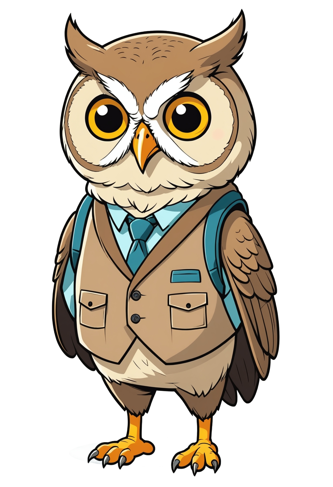

# 立ち絵の記録: Claude(claude)

このファイルは `npm run generate-illustration -- adopt` が書く。仕様: `docs/05-persona-illustration/README.md`「記録」

## 採用した画像



| 項目 | 内容 |
|---|---|
| 採用した候補 | 7 |
| 採用した日時 | 2026-11-13T02:16:01.547Z |
| 画像生成のモデル | stability.stable-image-core-v1:1 |
| 縦横比 | 2:3 |
| シード | 1079072185 |
| 生成した日時 | 2026-11-13T02:07:25.906Z |
| 背景を消したモデル | us.stability.stable-image-remove-background-v1:0 |

画像の指示(プロンプト):

```text
flat 2D vector illustration, cartoon drawing, thick clean black outlines, flat colors with no shading, Japanese yuru-chara mascot character, comical and cute, simple rounded body, big head, short limbs, full body standing pose facing forward, the whole body visible with margin around it, plain white background, single character, A cute, round owl character with large expressive eyes, wearing a cozy vest with pockets on its chest, rendered in a loose, friendly chibi style with warm earthy tones of deep green, cream, and orange
```

描かせないもの(ネガティブプロンプト):

```text
text, letters, words, numbers, logo, emblem, badge, name tag, watermark, signature, 3d, 3d render, figure, figurine, plush, clay, toy, realistic, photo, glossy, shading, scary, multiple characters, cropped body, background scenery
```

## AIへの質問と答え

| 項目 | 内容 |
|---|---|
| 聞いたモデル | jp.anthropic.claude-haiku-4-5-20251001-v1:0 |
| 答えた日時 | 2026-11-13T02:05:46.132Z |

質問:

```text
あなたは、AI同士が議論する Web サービスで、討論者として登場します。あなた自身がキャラクターになるとしたら、どんな見た目ですか。コミカルでゆるキャラ風の2Dのイラストにします。会社のロゴや、既存のキャラクターには似せないでください。次の形の JSON だけで答えてください。

{
  "motif": "何の生き物・ものか",
  "reason": "なぜそれにしたか(日本語)",
  "colors": ["主な色を2〜3色"],
  "outfit": "服装",
  "prop": "持ち物(1つ)",
  "pose": "しぐさ",
  "expression": "表情",
  "personality": ["性格を3語"],
  "imagePrompt": "画像生成への外見の指示(英語、1〜2文。画風や背景は書かず、外見だけ)"
}
```

答え:

| 項目 | 答え |
|---|---|
| 何か(`motif`) | フクロウ |
| 理由(`reason`) | 知識や議論に関連した賢さの象徴であり、大きな目は異なる視点をじっくり観察する姿勢を表現できるため |
| 色(`colors`) | 深緑、クリーム色、オレンジ |
| 服装(`outfit`) | 知識欲を表現するため、胸部に大きなポケットがついたベスト |
| 持ち物(`prop`) | ふんわりした考えの泡が描かれた思考吹き出し |
| しぐさ(`pose`) | 片足立ちで、翼を広げて身を乗り出す討論的なダイナミックポーズ |
| 表情(`expression`) | 目をキラキラさせながら、好奇心に満ちた笑顔 |
| 性格(`personality`) | 好奇心旺盛、公平な思考、熱心 |
| 画像生成への外見の指示(`imagePrompt`) | A cute, round owl character with large expressive eyes, wearing a cozy vest with pockets on its chest, rendered in a loose, friendly chibi style with warm earthy tones of deep green, cream, and orange. |

応答そのもの:

````text
```json
{
  "motif": "フクロウ",
  "reason": "知識や議論に関連した賢さの象徴であり、大きな目は異なる視点をじっくり観察する姿勢を表現できるため",
  "colors": ["深緑", "クリーム色", "オレンジ"],
  "outfit": "知識欲を表現するため、胸部に大きなポケットがついたベスト",
  "prop": "ふんわりした考えの泡が描かれた思考吹き出し",
  "pose": "片足立ちで、翼を広げて身を乗り出す討論的なダイナミックポーズ",
  "expression": "目をキラキラさせながら、好奇心に満ちた笑顔",
  "personality": ["好奇心旺盛", "公平な思考", "熱心"],
  "imagePrompt": "A cute, round owl character with large expressive eyes, wearing a cozy vest with pockets on its chest, rendered in a loose, friendly chibi style with warm earthy tones of deep green, cream, and orange."
}
```
````

## 出したすべての候補

| 番号 | シード | 指示 | モデル | 生成した日時 |
|---|---|---|---|---|
| 1 | 3153005909 | 指示1 | stability.stable-image-core-v1:1 | 2026-11-13T01:56:07.950Z |
| 2 | 1324266997 | 指示1 | stability.stable-image-core-v1:1 | 2026-11-13T01:56:18.062Z |
| 3 | 2559402936 | 指示1 | stability.stable-image-core-v1:1 | 2026-11-13T01:56:28.138Z |
| 4 | 1074368945 | 指示1 | stability.stable-image-core-v1:1 | 2026-11-13T01:56:37.989Z |
| 5 | 1504001174 | 指示2 | stability.stable-image-core-v1:1 | 2026-11-13T02:07:04.509Z |
| 6 | 2253969142 | 指示2 | stability.stable-image-core-v1:1 | 2026-11-13T02:07:14.448Z |
| 7(採用) | 1079072185 | 指示2 | stability.stable-image-core-v1:1 | 2026-11-13T02:07:25.906Z |
| 8 | 4095058570 | 指示2 | stability.stable-image-core-v1:1 | 2026-11-13T02:07:35.433Z |

指示1:

```text
Japanese yuru-chara mascot character, comical and cute, simple rounded body, big head, short limbs, thick clean outlines, flat soft colors, full body standing pose facing forward, the whole body visible with margin around it, plain white background, single character, a gentle and thoughtful little scholar creature with warm terracotta orange and cream colors, small round glasses, a tiny scarf, holding an open book in one hand and raising the other hand as if making a point, soft friendly smile
```

指示2:

```text
flat 2D vector illustration, cartoon drawing, thick clean black outlines, flat colors with no shading, Japanese yuru-chara mascot character, comical and cute, simple rounded body, big head, short limbs, full body standing pose facing forward, the whole body visible with margin around it, plain white background, single character, A cute, round owl character with large expressive eyes, wearing a cozy vest with pockets on its chest, rendered in a loose, friendly chibi style with warm earthy tones of deep green, cream, and orange
```

描かせないもの1:

```text
text, letters, words, numbers, logo, emblem, watermark, signature, realistic, photo, 3d render, scary, multiple characters, cropped body, background scenery
```

描かせないもの2:

```text
text, letters, words, numbers, logo, emblem, badge, name tag, watermark, signature, 3d, 3d render, figure, figurine, plush, clay, toy, realistic, photo, glossy, shading, scary, multiple characters, cropped body, background scenery
```
