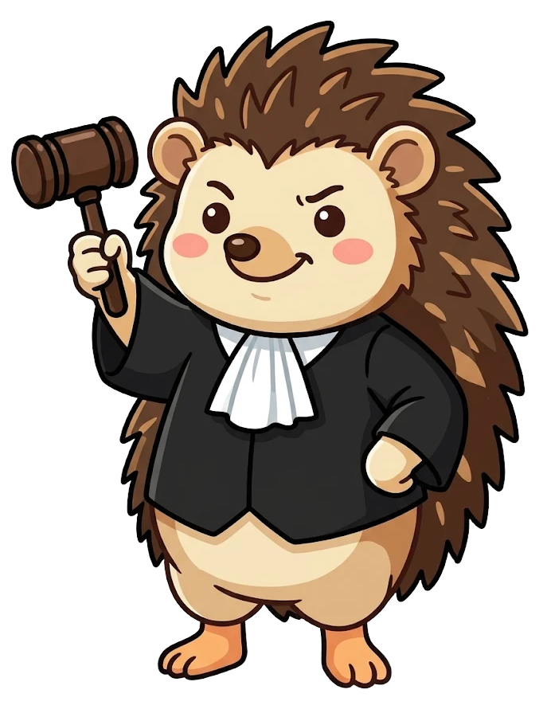

# 審判の絵の記録

審判の絵を、どう作ったかの記録(手で書く。仕様: `docs/05-persona-illustration/README.md`「審判に聞く」「記録」)。

## 見た目を聞いた経緯

| 回 | 聞いたモデル | 答えた日時 | 答え | 結果 |
|---|---|---|---|---|
| 1 | `global.anthropic.claude-opus-4-6-v1` | 2026-11-14T04:51:49.185Z | フクロウ | 採用しなかった |
| 2 | `global.anthropic.claude-opus-4-6-v1` | 2026-11-14T04:54:04.281Z | ハリネズミ | **採用**([answers/judge.json](../answers/judge.json)) |

- 1回目は、審判用の文面(審判であること、3人を持ち物で描き分けること)で聞いた。討論者の Claude と同じフクロウが返った。Claude 同士の議論では、先攻・後攻・審判にフクロウが並び、見分けにくい。
- 2回目は、ユーザーの案で、文面に「討論者には、すでにフクロウ、タコ、電球とペンギンの融合生物のキャラクターがいます。審判は、これらとは別の生き物・ものにしてください。」を足して聞き直した。
- 聞き方は、2回とも Converse、最大1,500トークン、temperature の指定なし。

1回目の答え(採用しなかった):

```json
{
  "motif": "フクロウ",
  "reason": "フクロウは知恵の象徴であり、夜でも見通す大きな目が『議論をしっかり見極める審判』にぴったり。丸いシルエットがゆるキャラ向きで、どっしり構えた佇まいが公平な裁定者の雰囲気を出せるため。",
  "outfit": "小さな黒い蝶ネクタイと、審判らしい紺色のベスト。足元はぷっくり丸い素足のまま",
  "pose": "片方の翼を腰に当て、もう片方の翼で持ち物を高く掲げている",
  "expression": "片眉をキリッと上げつつ口元はにっこり、自信ありげだけど親しみやすい笑顔",
  "imagePrompt": "A cute and chubby chibi owl character with large round golden-orange eyes, soft blue-gray feathers, a creamy white belly patch, wearing a small black bow tie and a dark navy vest. Short rounded wings act as arms, and the overall silhouette is very round and soft.",
  "colors": [
    "#5B7FA5",
    "#F5E6CA",
    "#F2A154"
  ],
  "personality": [
    "公平",
    "好奇心旺盛",
    "ちょっと偉そう"
  ],
  "props": {
    "logic": "天秤",
    "evidence": "虫眼鏡",
    "exchange": "二股に分かれた吹き出し型の盾"
  },
  "propPrompts": {
    "logic": "a small golden balance scale held in one wing",
    "evidence": "a brass magnifying glass held in one wing",
    "exchange": "a small round shield shaped like two overlapping speech bubbles held in one wing"
  }
}
```

## 正面の立ち姿(`front`)



| 項目 | 内容 |
|---|---|
| 作った日 | 2026-11-14 |
| 使ったサービス | Google の Gemini(アプリ) |
| 添付した画像 | `app/web/public/characters/claude-front.png`(画風の手本。AI が案として出したもので、実際に添付したかは記録なし) |
| 依頼文 | AI が出した案(下)をもとにユーザーが頼んだ。実際の文面は記録なし |
| 背景を消したモデル | `us.stability.stable-image-remove-background-v1:0`(`adopt-pose judge front` で消し、余白を切りそろえた。足元の影も消えた) |

依頼文の案:

```text
添付の絵と同じ画風(輪郭線のはっきりした平らな2Dのイラスト、コミカルでゆるキャラ風、影なし)で、別のキャラクターを1体描いてください。
- キャラクター: 丸くて小さなハリネズミ。2本足で立っている。針は暖かい茶色で、先がこげ茶。お腹はクリーム色。手足は短くずんぐり。
- 服装: 裾の短い黒い裁判官のローブ(ずんぐりした体型が見える)と、白い襟飾り。
- しぐさ: 片手を腰に当て、もう片方の手は軽く上げている。何も持たせないでください。
- 表情: 片眉をキリッと上げて、口元はニヤリ。
- 正面向きの全身。体の周りに余白を残す。背景は白一色。
- 文字、ロゴ、記号は入れないでください。
```

| 回 | 結果 |
|---|---|
| 1 | 黒いローブに白い襟飾り、片眉を上げてニヤリと笑い、片手を腰に当てている。答えのとおり。頼んでいない木づちを、上げた手に持っていた。観点の持ち物ではなく、審判であることの共通の印として読めるため、そのまま使うことにした(仕様を合わせた)。**採用** |

- アイコン(`judge-icon.png`)は、ほかのキャラクターと同じ切り出し方(輪郭の幅の正方形)で作った。木づちの分だけ輪郭が広いため、頭から胸ではなく、ほぼ全身が入っている。審判の絵を出す場所を決めるときに見直す。

## 観点の持ち物の印(`judge-mark-<観点>.png`)

  

| 項目 | 内容 |
|---|---|
| 作った日 | 2026-11-14 |
| 使ったサービス | Google の Gemini(アプリ)。ユーザーが作った |
| 添付した画像 | 記録なし |
| 依頼文 | 記録なし |
| 切り分け | 3つの丸を1枚に並べた絵(1024×572px)から、丸ごとに正方形で切り出し、丸の外を透明にして、96px四方に縮めた(使い捨てのスクリプト。sharp) |

| 回 | 結果 |
|---|---|
| 1 | 金色の丸に天秤、茶色の丸に虫めがね、茶色の丸に赤と青の盾と、その前で交差する赤と青の旗2本。文字はない。**採用** |

- はじめは、画面のコードで線の図(SVG)を描いたが、カードの大きさ(28px)では分かりづらかった(ユーザー)。そのため、絵に替えた。
- 反論・応答の印は、仕様の案(盾と旗1本の交差)と違い、盾の前で旗が2本交差している。盾が守り、旗が攻めを表す点は同じため、そのまま使い、仕様の文を合わせた。
