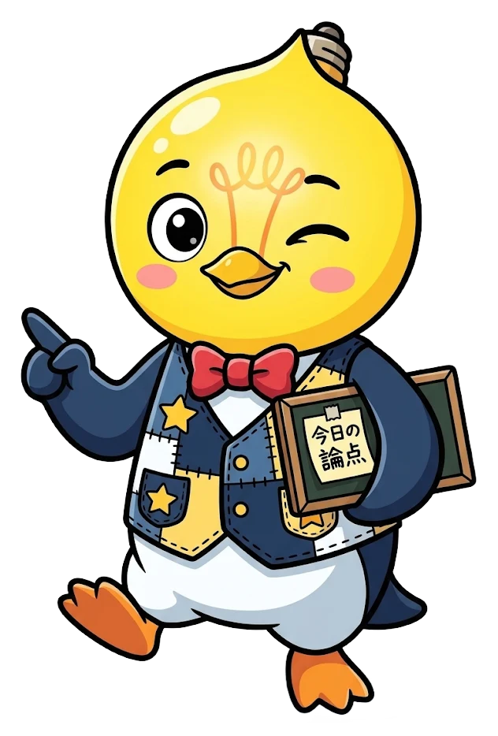
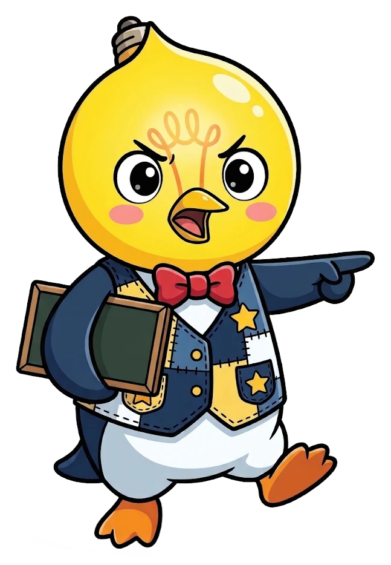
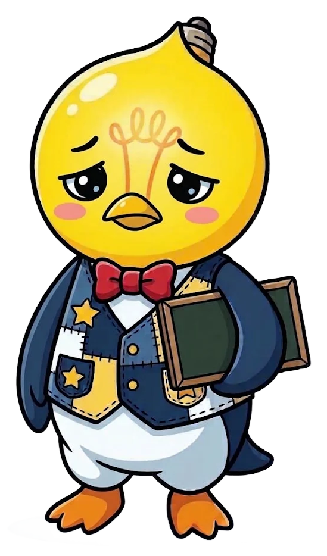
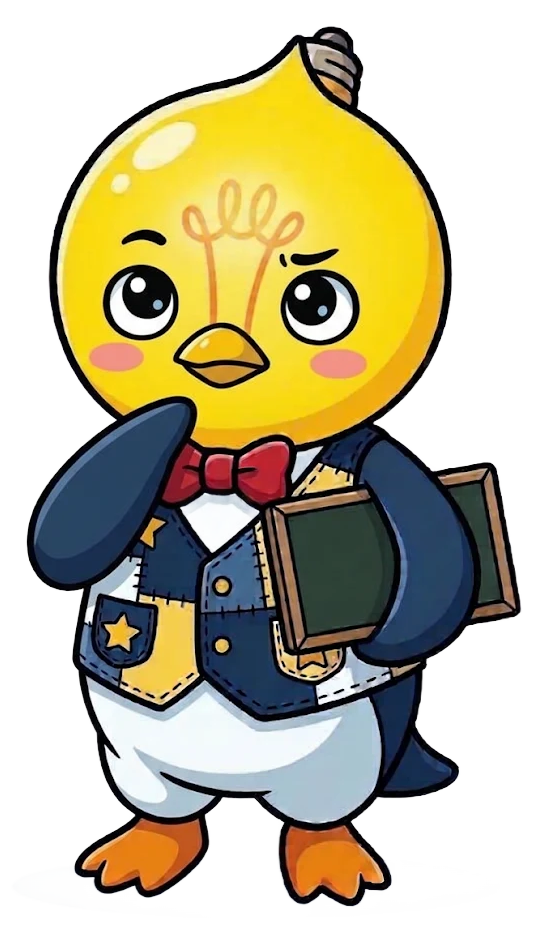

# Mistral の絵の記録

ツールの外で作った絵(正面の立ち姿と、ほかのポーズ)を、どう作ったかの記録(手で書く。仕様: `docs/05-persona-illustration/README.md`「見た目をAIに聞く」「ポーズ」「記録」)。Mistral は正面の立ち姿もツールの外で作ったため、`mistral.record.md` はない。

## 見た目を聞いた経緯

| 回 | 聞いたモデル | 答えた日時 | 答え | 結果 |
|---|---|---|---|---|
| 1 | `mistral.mistral-large-3-675b-instruct` | [answers/mistral.json](../answers/mistral.json) の `answeredAt` | 電球とペンギンの融合生物 | **採用** |

- 質問の文面と聞き方は、Claude・OpenAI のときと同じ。
- 理由に「議論好きな姿」とあり、議論の場を踏まえていたため、聞き直さなかった。

## 正面の立ち姿(`front`)

| 項目 | 内容 |
|---|---|
| 作った日 | 2026-11-13 |
| 使ったサービス | Google の Gemini(アプリ) |
| 添付した画像 | 記録なし |
| 依頼文 | 記録なし |
| 背景を消したモデル | `us.stability.stable-image-remove-background-v1:0`(`adopt-pose mistral front` で消し、余白を切りそろえた) |

| 回 | 結果 |
|---|---|
| 記録なし | 電球の形の黄色い頭(中にフィラメント、上に口金)、ペンギンの体、ウィンク。蝶ネクタイ、星の付いたパッチワーク風のベスト、「今日の論点」のメモを張った黒板を抱え、片手で指さして踏み出している。答えのとおり。**採用** |

- 黒板のメモに「今日の論点」の文字が入っている。答え(持ち物)に書かれていたもの。共通の「描かせないもの」には文字(text)があるが、ツールの外で作ったため効いていない。
- Stability AI(ツール)では候補を出していない。タコが描けなかったため、はじめから Gemini で作った。

## 右を指さして言い合う(`debate`)

| 項目 | 内容 |
|---|---|
| 作った日 | 2026-11-13 |
| 使ったサービス | Google の Gemini(アプリ) |
| 添付した画像 | 記録なし |
| 依頼文 | 記録なし |
| 背景を消したモデル | `us.stability.stable-image-remove-background-v1:0`(`adopt-pose mistral debate` で消し、余白を切りそろえた) |

| 回 | 結果 |
|---|---|
| 1 | 怒った顔で口を開け、片手で指さして踏み出している。服、黒板、色は正面の立ち姿と同じ。ただし左向きで、黒板のメモに「今日の論点」の文字があった。左右を反転すると鏡文字になる。AI が反転したうえでメモの文字だけを反転し直したが、カットインで後攻の側は絵をもう一度反転するため、そこでまた鏡文字になる。採用しなかった |
| 2 | 黒板を文字のない無地にして頼み直した(ユーザー)。左向きのままだったため、AI が左右を反転して右向きにして置いた。文字がないので、反転しても問題がない。**採用** |

## 勝って喜ぶ(`win`)

| 項目 | 内容 |
|---|---|
| 作った日 | 2026-11-14 |
| 使ったサービス | Google の Gemini(アプリ) |
| 添付した画像 | 記録なし |
| 依頼文 | 記録なし |
| 背景を消したモデル | `us.stability.stable-image-remove-background-v1:0`(`adopt-pose mistral win` で消し、余白を切りそろえた) |

| 回 | 結果 |
|---|---|
| 1 | 目を閉じて大きく笑い、片方の翼を振り上げて踏み出している。黒板のメモに「今日の論点」の文字があった。結果の節では後攻の絵を左右反転するため、鏡文字になる。採用しなかった |
| 2 | 黒板を文字のない無地にして頼み直した(ユーザー)。**採用** |

## 負けて落ち込む(`lose`)

| 項目 | 内容 |
|---|---|
| 作った日 | 2026-11-14 |
| 使ったサービス | Google の Gemini(アプリ) |
| 添付した画像 | 記録なし |
| 依頼文 | 記録なし |
| 背景を消したモデル | `us.stability.stable-image-remove-background-v1:0`(`adopt-pose mistral lose` で消し、余白を切りそろえた) |

| 回 | 結果 |
|---|---|
| 記録なし | 眉が下がって目がうるみ、くちばしを閉じてうつむき気味。翼を下ろして立っている。黒板は文字のない無地。**採用** |

## 考え込む(`think`)

| 項目 | 内容 |
|---|---|
| 作った日 | 2026-11-14 |
| 使ったサービス | Google の Gemini(アプリ) |
| 添付した画像 | 記録なし |
| 依頼文 | 記録なし |
| 背景を消したモデル | `us.stability.stable-image-remove-background-v1:0`(`adopt-pose mistral think` で消し、余白を切りそろえた) |

| 回 | 結果 |
|---|---|
| 記録なし | 片方の眉を上げて上を見上げ、翼をあごに当てて考えている。黒板は文字のない無地。**採用** |
