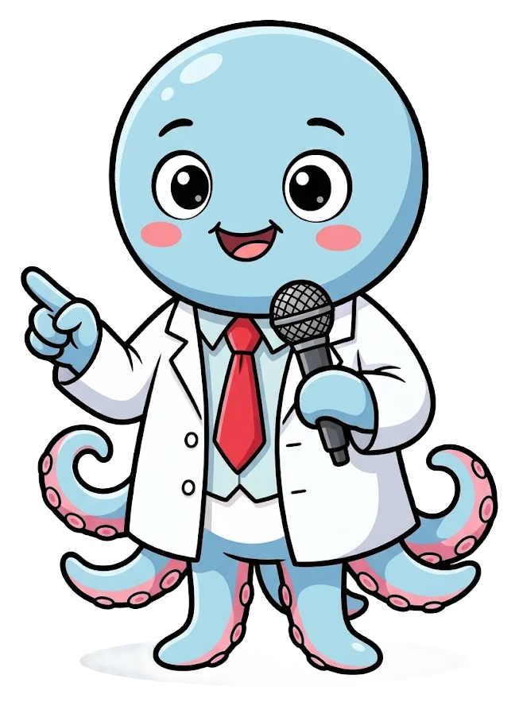
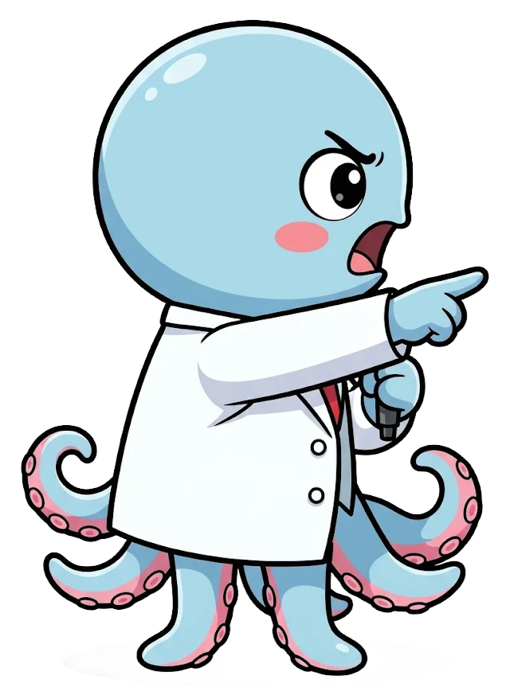
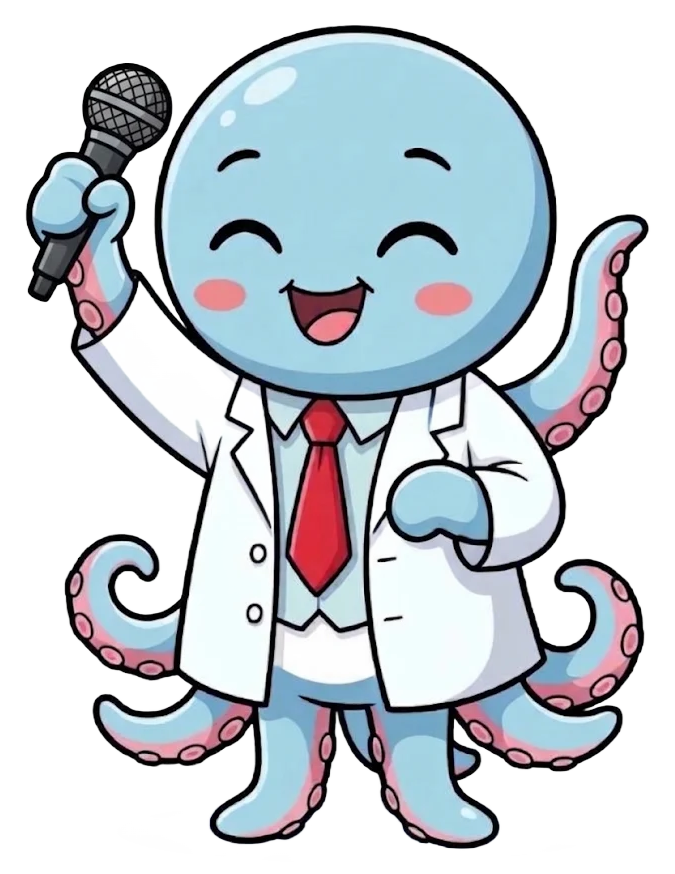
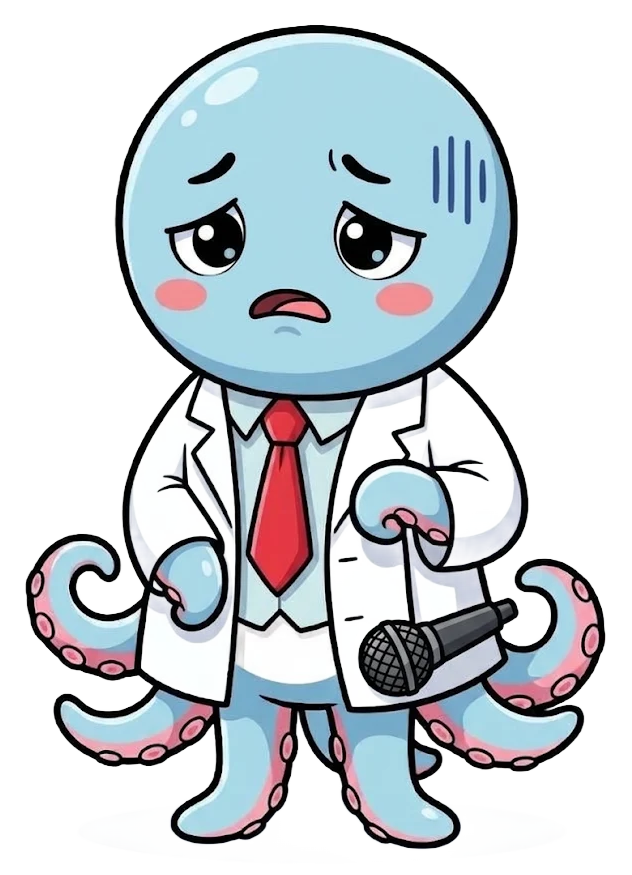
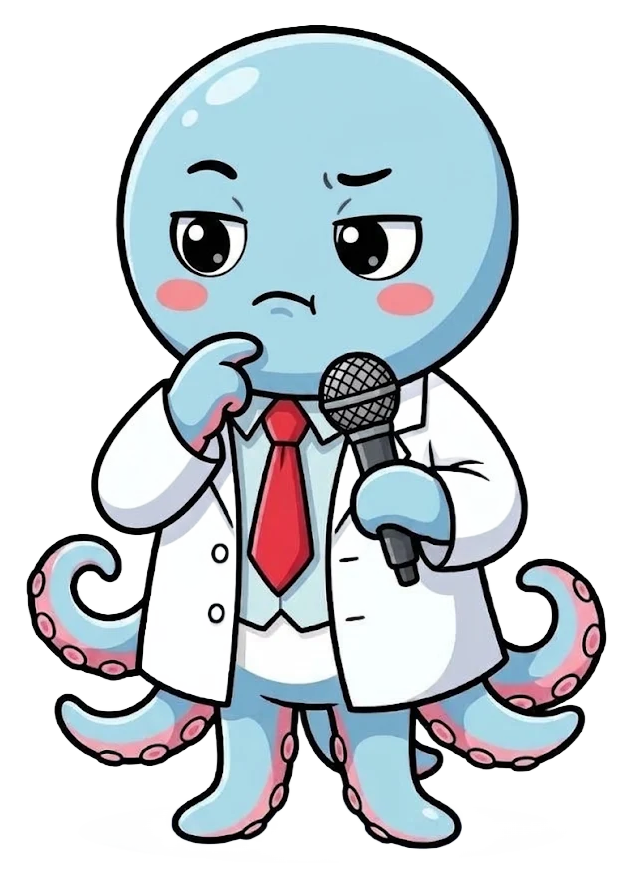

# OpenAI の絵の記録

ツールの外で作った絵(正面の立ち姿と、ほかのポーズ)を、どう作ったかの記録(手で書く。仕様: `docs/05-persona-illustration/README.md`「見た目をAIに聞く」「ポーズ」「記録」)。OpenAI は正面の立ち姿もツールの外で作ったため、`openai.record.md` はない。

## 見た目を聞いた経緯

| 回 | 聞いたモデル | 答えた日時 | 答え | 結果 |
|---|---|---|---|---|
| 1 | `openai.gpt-oss-120b-1:0` | 2026-11-13(時刻は記録なし) | ニンジン形の蒸しパン | 採用しなかった |
| 2 | `openai.gpt-oss-120b-1:0` | 2026-11-13T11:54:39Z ごろ(応答を保存したファイルの時刻) | タコ | **採用**([answers/openai.json](../answers/openai.json)) |

- 質問の文面は、2回とも Claude のときと同じ(`docs/05-persona-illustration/README.md`「見た目をAIに聞く」)。聞き方も同じ(Converse、最大1,500トークン、temperature の指定なし)。
- 1回目の答えは、理由が「みんなが好きなやわらかい蒸しパンをモチーフにすれば、親しみやすく温かみのある印象になるからです。」で、討論者として出ることを踏まえていなかった。ユーザーが「議論するキャラとして質問したのか」と疑い、同じ質問をもう1回聞いた。
- 1回目の答えで、Stability AI(Stable Image Core)の正面の候補を8枚出し、候補4を一度採用して、指さしの絵(Gemini)まで作った。答えをタコに替えたため、それらの絵と記録は消した。

1回目の答え(採用しなかった):

```json
{
  "motif": "ニンジン形の蒸しパンのキャラクター",
  "reason": "みんなが好きなやわらかい蒸しパンをモチーフにすれば、親しみやすく温かみのある印象になるからです。",
  "colors": ["パステルピンク", "クリームホワイト", "薄いオレンジ"],
  "outfit": "小さな青いスカーフと白いエプロン",
  "prop": "ミニチュアの本",
  "pose": "片手を軽く上げて挨拶している",
  "expression": "にっこりとした笑顔",
  "personality": ["フレンドリー", "好奇心旺盛", "励まし上手"],
  "imagePrompt": "A cute chibi steamed bun shaped like a carrot, with a round fluffy body, two tiny arms and legs, a smiling face, pastel pink, cream and light orange colors, wearing a small blue scarf and a white apron, holding a miniature book while waving."
}
```

## 正面の立ち姿(`front`)



| 項目 | 内容 |
|---|---|
| 作った日 | 2026-11-13 |
| 使ったサービス | Google の Gemini(アプリ) |
| 添付した画像 | 記録なし |
| 依頼文 | 記録なし |
| 背景を消したモデル | `us.stability.stable-image-remove-background-v1:0`(`adopt-pose openai front` で消し、余白を切りそろえた) |

| 回 | 結果 |
|---|---|
| 記録なし | 水色の丸い頭、白衣に赤いネクタイ、右手にマイク、左手で指さし、ピンクの吸盤の触手。答え(白衣に赤いネクタイ、小さなマイク、片腕で指しながらマイクを持つ)のとおり。**採用** |

- 先に、ツール(Stable Image Core)で、答えの `imagePrompt` から候補を4枚出した(`out/openai-octopus/`。コミットしない)。どれもタコにならず、耳のある動物(犬、ウサギ、パンダ、キツネのような)が服を着て立っている絵になった。共通のスタイル指示の「丸い体、大きな頭、短い手足、正面を向いて立つ」に引っ張られたと考えている(推測)。

## 右を指さして言い合う(`debate`)



| 項目 | 内容 |
|---|---|
| 作った日 | 2026-11-13 |
| 使ったサービス | Google の Gemini(アプリ) |
| 添付した画像 | 記録なし |
| 依頼文 | 記録なし |
| 背景を消したモデル | `us.stability.stable-image-remove-background-v1:0`(`adopt-pose openai debate` で消し、余白を切りそろえた) |

| 回 | 結果 |
|---|---|
| 記録なし | 体ごと右を向き、右手で右を指さし、左手でマイクを持っている。怒った顔で口を開けている。白衣、赤いネクタイ、色は正面の立ち姿と同じ。**採用** |

## 勝って喜ぶ(`win`)



| 項目 | 内容 |
|---|---|
| 作った日 | 2026-11-13 |
| 使ったサービス | Google の Gemini(アプリ) |
| 添付した画像 | 記録なし |
| 依頼文 | 記録なし |
| 背景を消したモデル | `us.stability.stable-image-remove-background-v1:0`(`adopt-pose openai win` で消し、余白を切りそろえた) |

| 回 | 結果 |
|---|---|
| 記録なし | 目を細めて大きく笑い、右手でマイクを高く掲げ、左手は胸の前。後ろの触手も1本持ち上がっている。白衣、赤いネクタイ、色は正面の立ち姿と同じ。**採用** |

## 負けて落ち込む(`lose`)



| 項目 | 内容 |
|---|---|
| 作った日 | 2026-11-13 |
| 使ったサービス | Google の Gemini(アプリ) |
| 添付した画像 | 記録なし |
| 依頼文 | 記録なし |
| 背景を消したモデル | `us.stability.stable-image-remove-background-v1:0`(`adopt-pose openai lose` で消し、余白を切りそろえた) |

| 回 | 結果 |
|---|---|
| 記録なし | 眉が下がって目がうるみ、口がへの字。額に青ざめた線。マイクを下に落としかけている。白衣、赤いネクタイ、色は正面の立ち姿と同じ。**採用** |

## 考え込む(`think`)



| 項目 | 内容 |
|---|---|
| 作った日 | 2026-11-13 |
| 使ったサービス | Google の Gemini(アプリ) |
| 添付した画像 | 記録なし |
| 依頼文 | 記録なし |
| 背景を消したモデル | `us.stability.stable-image-remove-background-v1:0`(`adopt-pose openai think` で消し、余白を切りそろえた) |

| 回 | 結果 |
|---|---|
| 記録なし | 片方の眉を上げて目を細め、口をすぼめている。右手をあごに当て、左手でマイクを持っている。白衣、赤いネクタイ、色は正面の立ち姿と同じ。**採用** |
